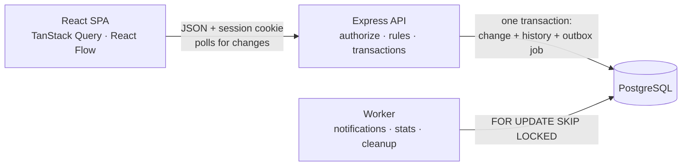

# Newtonite Ops

An internal web application for coordinating operational work such as incidents, customer issues,
payment investigations, compliance requests and approvals. Each project has a shared canvas showing
its workflow and every work item with its owner. The server enforces permissions, workflow rules and
safe concurrent edits, keeps an append-only history, and delivers notifications reliably.

Submission for the Newtonite Software Engineering Challenge, *Operations Under Pressure*.

## Quick start

**Prerequisite:** Docker Desktop (Docker Compose 2.24 or newer).

```bash
git clone https://github.com/Alok-kumar-priyadarshi/newtonite-ops-2300970100033.git
cd newtonite-ops-2300970100033
docker compose up --build
```

Open **http://localhost:8080** and choose a user under **Sign in as…**. The first start migrates the
database and seeds about 20,000 work items (~20 s). No settings file is needed; to switch on the
optional Ask assistant, copy `backend/.env.example` to `backend/.env` and set `GROQ_API_KEY`.

For running the database, backend and frontend separately, developer mode, resetting data and
troubleshooting, see **[RUNNING.md](RUNNING.md)**.

## Demo users

Password for every account: **`Demo@1234`**

| User | Email | Role |
|---|---|---|
| Neha Kapoor | neha@newtonite.test | Admin: teams, projects, users, failed jobs |
| Anita Verma | anita@newtonite.test | Manager, Vendor Payments |
| Ravi Sharma | ravi@newtonite.test | Lead, Vendor Payments · Member, SOC2 Evidence |
| Meera Pillai | meera@newtonite.test | Member, Vendor Payments |
| Arjun / Kabir / Priya | arjun@ · kabir@ · priya@ | Manager / Lead / Member, Production Incidents |
| Sameer / Divya / Rohan | sameer@ · divya@ · rohan@ | Manager / Lead / Member, Customer Escalations |
| Isha / Vikram | isha@ · vikram@ | Manager / Lead, SOC2 Evidence |
| Tara Bose | tara@newtonite.test | No project: sees nothing (outsider) |

## Tests

```bash
npm install
npm test
```

Starts a throwaway PostgreSQL (port 55432) and runs 80 API tests against it plus 6 frontend unit tests.
They cover concurrent claims, stale writes, idempotency, workflow rules, resource-level authorization,
the outbox and history. See [docs/11-test-plan.md](docs/11-test-plan.md).

## Features

- **Dashboard:** assigned to me, awaiting my approval, unassigned urgent, overdue, blocked, and
  forgotten (no activity for 5 days).
- **Project canvas:** stages, allowed moves (with approval, reason or Lead-only markers) and item
  cards showing their owner. Drag a card to move it; if the server refuses, it snaps back with the
  reason. Members can add stages, connections, notes and drawings.
- **Lists and search:** server-side filters, full-text search, jump to key (`PAY-42`), cursor
  pagination, filters kept in the URL.
- **Item detail:** claim, change stage, approve or reject, reassign, priority with reason, next action,
  blockers, notes, and a timeline recording each actor's role at the time.
- **People and teams:** profiles with role history and activity; every member can see the team.
- **Notifications:** delivered through a transactional outbox and a background worker.
- **Admin:** teams, projects from workflow templates, users, failed background jobs with retry.
- **Ask (optional):** a chat assistant (Groq `openai/gpt-oss-120b`) that answers questions through
  read-only tools running with the user's own permissions. Enabled by setting `GROQ_API_KEY` in
  `backend/.env` ([docs/13-assistant.md](docs/13-assistant.md)).

## Architecture



Every write performs one permission check and one rule check, then saves the change, its history
event and its outbox job in a single transaction.

| Folder | Contents |
|---|---|
| [`backend/`](backend) | Express API, domain rules, SQL migration, seed, background worker, tests |
| [`frontend/`](frontend) | React app: dashboard, canvas, lists, item detail, admin |
| [`shared/`](shared) | Validation schemas, types, error codes and limits used by both |
| [`docs/`](docs/README.md) | Design documents: data model, workflow rules, permissions, API, failure scenarios |

Locally, Docker runs both together (the API serves the built frontend). On Vercel they deploy as two
separate projects; see [docs/12-deployment.md](docs/12-deployment.md).

## Critical behaviours

| Situation | Handling | Tested by |
|---|---|---|
| Two people claim the same item | Single conditional `UPDATE … WHERE assignee_id IS NULL`; the loser gets 409 naming the owner | 10 parallel claims → exactly one winner |
| Editing stale data | `version` on every item and canvas element; 409 returns current data and what changed | Stale update rejected, row unchanged |
| Repeated requests | `Idempotency-Key` stored with the response in the same transaction; duplicates replay it | Same key, sequential and parallel → one item |
| Workflow rules | Workflow stored as a graph; `checkTransition()` enforces allowed moves, Lead-only moves, approval by someone other than creator or assignee, blockers and reasons; edits cannot create an approval bypass | Invalid moves, self-approval and bypass rejected |
| Resource-level authorization | Queries scoped to the caller's memberships; one `authorize()`; outsiders get 404, members get specific 403s | Outsider 404 on read, write and search; member delete → 403 |
| Reliable async work | Transactional outbox with leases, backoff, max attempts and idempotent handlers | Processed twice → one notification; failed job → admin retry |
| Optimistic UI | Immediate update, rollback with the server's reason, retry with the same key | Canvas move refused → card returns |

Design rationale: [ENGINEERING_DECISIONS.md](ENGINEERING_DECISIONS.md). Full design:
[docs/](docs/README.md).

## Known limitations

- Other users' changes arrive by polling (about 1–3 s on the canvas, 15–30 s elsewhere), not push.
- Every project member is notified of every change; large projects would need preferences.
- The canvas shows the top 20 cards per stage; the rest are reached through the list view.
- Dependencies appear as badges, not lines; no canvas undo.
- No login rate limiting.
- One company per deployment (`org_id` is present for a later multi-tenant move).
- The Vercel deployment (one project per folder) is verified locally but not covered by automated
  tests; Docker is the reference setup.

## Next steps

1. Per-user notification preferences and digests for large projects.
2. Server-sent events instead of polling for open canvases.
3. Login rate limiting.
4. Partition `activity_events` by month and feed a search index from the outbox.
5. Versioned workflows so in-flight items keep the workflow they started with.
6. Playwright end-to-end tests.
