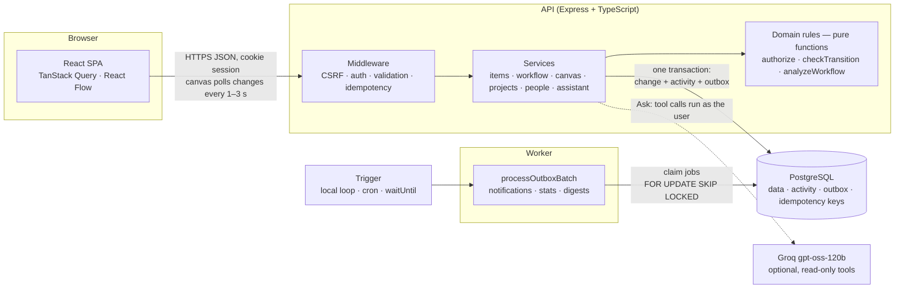
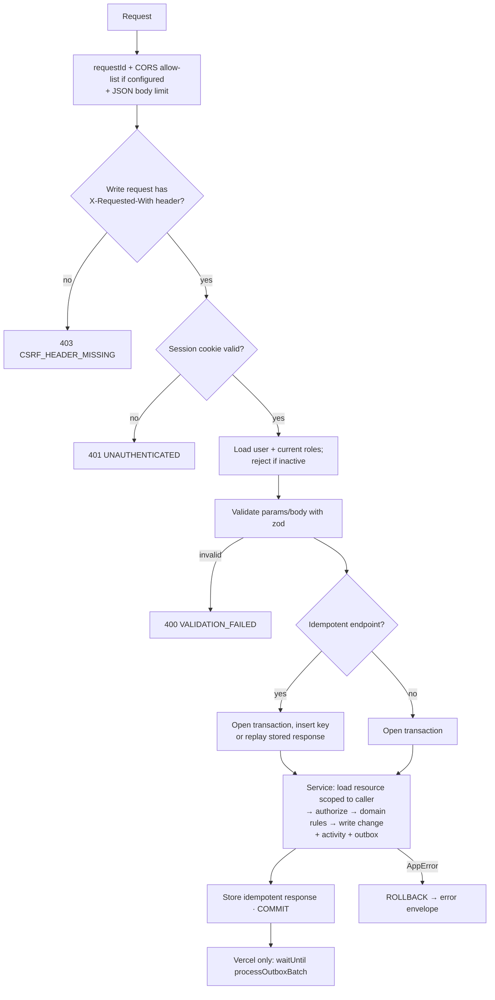

# 2. Architecture

## 2.1 System overview



**Postgres is the only stateful component.** It stores the data, the history, the job queue
(outbox), idempotency records and presence. No Redis, no message broker: fewer moving parts, and
the job queue shares transactions with the data it describes.

## 2.2 Components

| Component | Responsibility |
|---|---|
| **Web (React SPA)** | Screens, canvas, optimistic updates, polling. Holds no business rules beyond hints; every decision comes from the server. |
| **API** | Authentication, authorization, validation, business rules, transactions. Stateless; any instance can serve any request. |
| **Domain layer** | Pure functions with no I/O: `authorize`/`can` (permissions), `checkTransition`/`allowedTransitions`/`blockedTransitions` (moves), `analyzeWorkflow` (graph rules), `describeEvent` (wording). Unit-tested without a database. |
| **Assistant** (optional) | Tool-calling loop against Groq; tools reuse the services above as the signed-in user ([13](13-assistant.md)). |
| **Worker** | Processes the outbox: fans out notifications, groups canvas digests, updates people stats. Same code base as the API. |
| **PostgreSQL 17** | Source of truth. Transactions, row locks, constraints, partial indexes, full-text search. |

## 2.3 Environments

| | Local / reviewer | Production demo |
|---|---|---|
| Database | Postgres container | Neon Postgres (pooled connection) |
| API | Node process (container) | Vercel project `backend`: one serverless function |
| Web | Built SPA served by the API at `http://localhost:8080` | Vercel project `frontend`: static files; `/api/*` forwarded to the backend project |
| Worker trigger | `worker` container loops every 2 s | Every minute from an external scheduler hitting `POST /api/internal/outbox/run`, plus `waitUntil()` after each write request |
| Start | `docker compose up --build` | Git push |

The worker logic is one function, `processOutboxBatch(limit)`. Only its **trigger** differs per
environment. Correctness comes from the outbox; the trigger only decides how quickly jobs run.

## 2.4 Code layout

```
newtonite-ops-2300970100033/
├── backend/                          # API + worker (Express, PostgreSQL)
│   ├── src/
│   │   ├── app.ts                    # builds the Express app (used by every entry point)
│   │   ├── server.ts                 # entry: app.listen() (Docker, local)
│   │   ├── worker.ts                 # entry: loop calling processOutboxBatch() (Docker, local)
│   │   ├── vercel.ts                 # entry: Vercel function (drains jobs after writes)
│   │   ├── config.ts                 # env parsing (zod)
│   │   ├── db.ts                     # postgres.js pool + withTransaction()
│   │   ├── migrate.ts / seed.ts      # migration runner, deterministic demo data
│   │   ├── domain/                   # PURE: no db, no http
│   │   │   ├── permissions.ts        # MATRIX, can(), authorize(), permissionsFor()
│   │   │   ├── transitions.ts        # checkTransition(), allowedTransitions(), blockedTransitions()
│   │   │   ├── workflow-graph.ts     # analyzeWorkflow(): hard rules + warnings
│   │   │   ├── describe.ts           # human wording for events and notifications
│   │   │   ├── actor.ts              # the signed-in user + roleIn()
│   │   │   └── errors.ts             # AppError + codes
│   │   ├── http/                     # auth + CSRF, CORS, error envelope, idempotent()/write()/read(), routes
│   │   ├── services/                 # items, item-list, workflow, canvas, projects, people, notifications,
│   │   │                             # presence, admin, activity (recordEvent), assistant/
│   │   └── outbox/                   # enqueue(), processOutboxBatch(), handlers, housekeeping
│   ├── migrations/001_init.sql       # the whole schema: tables, constraints, indexes, history trigger
│   ├── test/                         # unit tests + integration tests against real Postgres
│   ├── scripts/vercel-build.mjs      # Vercel build: bundles the API into one function
│   ├── .env.example                  # backend settings (copy to backend/.env)
│   └── vercel.json                   # Vercel project settings (Root Directory = backend)
├── frontend/                         # React SPA (Vite)
│   ├── src/
│   │   ├── api/                      # fetch client, query hooks, useSafeMutation (optimistic + rollback + keys)
│   │   ├── pages/                    # Home, Items, Item, Inbox, Projects, Settings, Deleted, Person, Admin, Login
│   │   ├── canvas/                   # React Flow canvas: sync layer, nodes, edges, panels
│   │   ├── components/               # app shell, item detail, conflict panel, dialogs, UI kit
│   │   └── lib/                      # formatting, activity wording
│   ├── scripts/vercel-build.mjs      # Vercel build: static files + /api forwarding to the backend
│   ├── .env.example                  # frontend settings (copy to frontend/.env)
│   └── vercel.json                   # Vercel project settings (Root Directory = frontend)
├── shared/                           # zod schemas, TS types, error codes, limits (used by both)
├── scripts/                          # npm run dev / npm test runners
├── docker-compose.yml                # db + migrate + api + worker (the API also serves the frontend)
├── docker-compose.test.yml           # throwaway test database
├── Dockerfile
├── README.md
└── ENGINEERING_DECISIONS.md
```

Routes are thin; services own transactions; the domain layer owns rules. A live change such as "add
a new status" or "let Leads reassign items" touches one place: the workflow data or the permission
matrix.

## 2.5 Request lifecycle



### The transaction rule

Simplified from `transitionItem()` in `services/items.ts`; `tx` is the transaction opened by the
`idempotent()` wrapper in `http/handlers.ts`:

```ts
await tx`select 1 from workflows where project_id = ${projectId} for share`; // workflow can't change under us
const row = await loadItemRow(tx, actor, itemId, { forUpdate: true });       // scoped to actor → 404; row lock
authorize(actor, 'item.transition', { projectId: row.project_id, assigneeId: row.assignee_id }); // 403
const workflow = await loadWorkflow(tx, row.project_id);
const decision = checkTransition(workflow, toTransitionState(row), { id: actor.id, role }, input); // pure rules
await tx`update work_items set stage_id = ${decision.to.id}, version = version + 1, …
         where id = ${itemId} and version = ${input.version}`;
await recordEvent(tx, { projectId, itemId, actor, type: decision.eventType, data: { from, to, reason } });
// recordEvent() inserts the activity row AND its outbox job, in this same transaction
```

## 2.6 Frontend state management

| State | Where it lives | Why |
|---|---|---|
| Server data (items, canvas, notifications) | TanStack Query cache | Caching, refetch on focus, polling, optimistic updates with rollback |
| Filters, search, selected view | URL query string | Shareable links, back button works, survives reload |
| Canvas viewport, selection, in-progress drags | React state inside the canvas component | Local and transient; never sent until a gesture ends |
| Pending canvas edits | A small in-memory map `elementId → pending change` | Lets polling skip elements the user is editing |
| Session user + memberships | Query `['me']` | Loaded once, refetched after 403/404 surprises |

Optimistic mutation pattern (used for claim, transition, priority, canvas edits):
`onMutate` snapshot + apply → `onError` restore snapshot + show server message (and on 409 write the
server's latest into the cache) → `onSettled` invalidate the affected queries.

## 2.7 Freshness without websockets

Each open screen polls a cheap endpoint:

* Canvas: `GET /api/projects/:id/changes?since=<serverTime>` every 3 s, every 1 s while changes keep
  arriving (people are actively working), and immediately after the user's own writes. Changed cards
  are patched into the cached canvas in place (no full reload); a full reload runs once a minute to
  refresh project counts. Measured: another user's card move appears in about 1 s.
* Lists and dashboard: refetch every 30 s.
* Item detail: `GET /api/items/:id` every 15 s plus presence heartbeat every 20 s.
* Bell: `GET /api/notifications/unread-count` every 15 s.
* All queries refetch on window focus.

The changes feed returns rows with `updated_at > since − 30 s`. The overlap covers transactions
that started before `since` but committed after it (their `updated_at` is the transaction start).
Statement timeout is 10 s, so 30 s is safe. The client merges by **version**: a row replaces the
cached one only if its version is higher, so seeing a row twice is harmless.

## 2.8 Technology choices

| Choice | Why | Alternative considered |
|---|---|---|
| TypeScript end to end | One language; shared zod schemas validate on both sides | Python/FastAPI: fine, but two languages and duplicated types |
| Express | Known by every reviewer; runs as a Vercel function unchanged | Fastify/NestJS: faster or more structured, more to explain |
| PostgreSQL | Transactions, row locks, `SKIP LOCKED`, partial indexes, full-text search in one system | MongoDB: weaker multi-document transactions for this shape of data |
| postgres.js + plain SQL migrations | Every query is visible SQL, so conditional updates, `FOR UPDATE`, `FOR SHARE` and `SKIP LOCKED` are explicit and easy to explain line by line. Parameters are always bound (no string concatenation) | Drizzle (planned originally): extra abstraction over exactly the queries that matter most; Prisma: hides SQL, awkward for conditional updates |
| TanStack Query | Built-in cache, polling, optimistic updates and rollback | Redux: much more code for the same behaviour |
| React Flow (`@xyflow/react`) | Custom node types, edges, zoom, minimap, read-only mode | Embedding Excalidraw: stores the scene as one blob, fights per-element versioning; tldraw: licence watermark for production |
| Postgres outbox | Job is atomic with the change; no extra infrastructure | BullMQ + Redis: second datastore, no shared transaction |
| bcryptjs | Pure JS, works on serverless without native builds | argon2: native binary, deployment friction |
| Vitest + Supertest + real Postgres | Concurrency bugs only appear against a real database | Mocked DB: would hide exactly the bugs we care about |

## 2.9 Scale

Target: thousands of users, hundreds to a few thousand concurrent, tens of thousands of active
items, ever-growing history.

What keeps v1 responsive:
* Every list is keyset-paginated (no `OFFSET`), backed by a matching index.
* Every query is filtered by project membership first, which narrows the data immediately.
* The canvas loads only the top 20 items per stage plus counts.
* History is paginated; profile stats are pre-computed by the worker, not counted on read.
* Polling endpoints return only rows changed since the last poll.
* No request loads a whole table into memory or the browser.

Performance findings fixed during development (measured on the 20k-item seed):

| Symptom | Cause | Fix | Before → after |
|---|---|---|---|
| Canvas took ~13 s to load after ~20 s of no activity | The pool closed idle DB connections, so the next request's ~10 parallel queries all reconnected at once (slow on Windows + Docker Desktop) | Keep idle connections open on long-running servers (`DB_IDLE_TIMEOUT=0`, recycle every 30 min) | 13.6 s → 30 ms |
| Project counts slow | Two correlated subqueries ran for every item row | Uncorrelated subqueries computed once (hashed lookup) | canvas API 48 → 17 ms |
| Other users' changes appeared late | 10 s polling + full canvas reload | Adaptive 3 s / 1 s polling, in-place patching | 8.4 s → ~1 s |
| Re-render work on zoom/drag | Every card re-rendered on each zoom step and page render | Zoom as 3 detail levels, memoized cards, stable canvas context | — |

What we would change at 10× scale:

| Pressure | Change |
|---|---|
| Activity table grows without limit | Partition `activity_events` by month; archive old partitions |
| Read load from polling | Read replicas for list/dashboard queries; push via websockets/SSE so idle clients stop polling |
| Search quality and load | Move search to OpenSearch/Meilisearch fed from the outbox |
| Notification fan-out to large projects | Batch inserts, per-user preferences, digest-by-default |
| Outbox throughput | Dedicated queue (SQS/Kafka) fed by the outbox relay |
| Hot project rows | Counter allocation in a separate table or sequence per project |
| Multi-tenant SaaS | Enforce `org_id` with Postgres row-level security |
