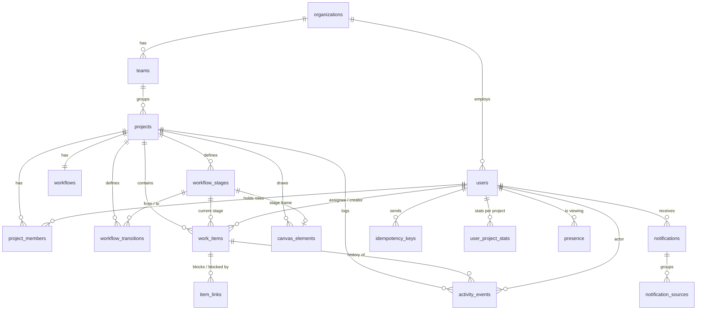

# 3. Data Model

PostgreSQL 17. All primary keys are UUIDs (generated with `gen_random_uuid()`) except the
append-only, ordered tables (`activity_events`, `outbox`, `notifications`) which use `bigint
identity` so their ids give a total order. All timestamps are `timestamptz(3)` in UTC: millisecond
precision round-trips exactly through JavaScript `Date`, which keyset-pagination cursors rely on.
The full schema is [`backend/migrations/001_init.sql`](../backend/migrations/001_init.sql).

## 3.1 Entity–relationship diagram



## 3.2 Enums

| Enum | Values |
|---|---|
| `project_role` | `manager`, `lead`, `member` |
| `project_health` | `on_track`, `at_risk`, `off_track`, `done` |
| `item_type` | `incident`, `customer_issue`, `payment`, `compliance`, `task` |
| `stage_kind` | `start`, `active`, `done` |
| `canvas_element_type` | `project_node`, `stage_frame`, `rectangle`, `ellipse`, `diamond`, `text`, `sticky`, `arrow`, `freehand` |
| `outbox_status` | `pending`, `processing`, `done`, `failed` |

Priority is a `smallint` 1–4 (P1 highest) so it sorts naturally. Note kinds (`note`, `decision`,
`handoff`, `blocker`) are validated by the API and stored in the event's `data.kind`.

## 3.3 Tables

### Identity and organization

**organizations** — `id`, `name`, `created_at`.

**users**

| Column | Type | Notes |
|---|---|---|
| id | uuid PK | |
| org_id | uuid FK | |
| email | text | unique on `lower(email)` |
| password_hash | text | bcrypt |
| full_name | text | |
| designation | text | job title, e.g. "Senior Finance Analyst" |
| department | text | |
| employee_code | text | unique per org, e.g. `EMP-0142` |
| avatar_color | text | hex colour for initials avatar |
| is_admin | boolean | company-wide Admin flag |
| is_active | boolean | inactive users are rejected on every request |
| created_at, updated_at | timestamptz | |

**teams** — `id`, `org_id`, `name` (unique per org), `created_at`.

### Projects and membership

**projects**

| Column | Type | Notes |
|---|---|---|
| id | uuid PK | appears in URLs |
| org_id, team_id | uuid FK | |
| key | varchar(5) | unique per org, uppercase, e.g. `PAY` |
| name | text | |
| goal | text | "Clear Q4 vendor payment exceptions before 31 Dec audit" |
| status_note | text | "Waiting on bank for 3 reversals" |
| health | project_health | |
| next_item_number | integer | per-project counter, starts at 1 |
| version | integer | optimistic lock for project node edits |
| created_by, updated_by | uuid FK users | `updated_by` shown on the project node ("updated by Anita") |
| created_at, updated_at | timestamptz | |

**project_members** — role history with validity periods.

| Column | Type | Notes |
|---|---|---|
| id | uuid PK | |
| project_id, user_id | uuid FK | |
| role | project_role | |
| valid_from | timestamptz | |
| valid_to | timestamptz null | `null` = current |
| added_by | uuid FK users | |
| reason | text | required for role changes and removals |

Constraints:
* `UNIQUE (project_id, user_id) WHERE valid_to IS NULL` — one current role per person per project.
* `UNIQUE (project_id) WHERE role = 'manager' AND valid_to IS NULL` — exactly one current Manager
  (enforced together with "cannot remove the last Manager" in the service).
* Index `(user_id) WHERE valid_to IS NULL` — "my projects" and every authorization check.

A role change closes the current row (`valid_to = now()`) and inserts a new one in the same
transaction, with an activity event. Rows are never deleted.

### Workflow

**workflows** — one row per project; the lock and version for workflow edits.
`project_id` (PK, FK), `version` integer, `updated_by`, `updated_at`.

**workflow_stages**

| Column | Type | Notes |
|---|---|---|
| id | uuid PK | |
| project_id | uuid FK | |
| name | text | unique per project (case-insensitive) |
| kind | stage_kind | exactly one `start` per project |
| requires_approval | boolean | protected stage: entering it is an approval |
| sort_order | integer | default left-to-right order for the list view |
| version | integer | for rename / flag changes |
| deleted_at | timestamptz null | soft delete (only when empty) |

**workflow_transitions**

| Column | Type | Notes |
|---|---|---|
| id | uuid PK | |
| project_id | uuid FK | |
| from_stage_id, to_stage_id | uuid FK | `CHECK (from_stage_id <> to_stage_id)` |
| label | text null | e.g. "Reject" |
| requires_reason | boolean | |
| lead_only | boolean | only Lead/Manager may use it |
| version | integer | |
| created_by | uuid | |
| deleted_at | timestamptz null | |

`UNIQUE (from_stage_id, to_stage_id) WHERE deleted_at IS NULL`.

### Work items

**work_items**

| Column | Type | Notes |
|---|---|---|
| id | uuid PK | |
| project_id | uuid FK | |
| number | integer | `UNIQUE (project_id, number)`; key shown as `PAY-4790` |
| type | item_type | |
| title | text | 1–200 chars |
| description | text | up to 10,000 chars |
| priority | smallint | `CHECK (priority BETWEEN 1 AND 4)` |
| stage_id | uuid FK workflow_stages | |
| assignee_id | uuid FK users null | |
| created_by | uuid FK users | |
| due_at | timestamptz null | |
| next_action | text null | |
| next_action_due_at | timestamptz null | |
| version | integer | starts at 1, +1 on every change |
| last_activity_at | timestamptz | updated on every change and note |
| created_at, updated_at | timestamptz | |
| deleted_at, deleted_by, delete_reason | | soft delete |
| search | tsvector | generated: title (weight A) + description (weight B) |

Indexes (all `WHERE deleted_at IS NULL` unless noted):

| Index | Serves |
|---|---|
| `(project_id, stage_id, priority, due_at, id)` | Canvas top-N per stage, stage counts |
| `(project_id, updated_at DESC, id DESC)` | Default list sort |
| `(project_id, updated_at)` (no `deleted_at` filter) | Changes feed: also returns deleted rows so screens can remove them |
| `(assignee_id, updated_at DESC, id DESC)` | Assigned to me |
| `(project_id, priority, created_at) WHERE assignee_id IS NULL` | Unassigned urgent |
| `(project_id, last_activity_at)` | Forgotten |
| `(project_id, due_at)` | Overdue / due soon |
| `(assignee_id, next_action_due_at) WHERE next_action IS NOT NULL` | Next actions due |
| `(project_id, deleted_at DESC) WHERE deleted_at IS NOT NULL` | Manager's "Deleted items" |
| `GIN (search)` | Full-text search |

**item_links** — `id`, `project_id`, `blocker_item_id`, `blocked_item_id`, `created_by`,
`created_at`. `UNIQUE (blocker_item_id, blocked_item_id)`, `CHECK (blocker_item_id <>
blocked_item_id)`. Both items must belong to `project_id` (checked in the service). Cycles are
rejected with a recursive query before insert.

### History

**activity_events** — append-only.

| Column | Type | Notes |
|---|---|---|
| id | bigint identity PK | total order |
| project_id | uuid | |
| item_id | uuid null | null for project / workflow / membership events |
| actor_id | uuid | `null` only for system events |
| actor_role | text | role **at the time**: `manager`, `lead`, `member`, `admin`, `system` |
| type | text | see list below |
| data | jsonb | before/after values, reason, note body, etc. |
| item_version | integer null | item version after this change |
| created_at | timestamptz | |

Indexes: `(item_id, id DESC)`, `(project_id, id DESC)`, `(actor_id, id DESC)`.

A trigger raises an exception on `UPDATE` or `DELETE`, so history cannot be rewritten even by a bug.

Event types:

```
item.created  item.updated  item.claimed  item.released  item.assigned  item.transitioned
item.approved item.rejected item.reopened item.deleted   item.restored  item.link_added
item.link_removed  note.added
project.created  project.updated  member.added  member.role_changed  member.removed
workflow.stage_added  workflow.stage_updated  workflow.stage_removed
workflow.transition_added  workflow.transition_updated  workflow.transition_removed
```

`item.updated` stores a field diff: `{"changes": {"priority": [3, 1]}, "reason": "Customer escalated"}`.
Notes are events of type `note.added` with `{"kind": "decision", "body": "…"}` so the timeline is
one query. Drawing-element changes on the canvas (create, move, restyle, delete) are **not**
history events (they would flood history); they are tracked by `canvas_elements.updated_by/updated_at`,
soft-deleted so they can be restored, and announced through grouped notifications. Workflow changes
made on the canvas (stages, connections) **are** history events.

### Canvas

**canvas_elements**

| Column | Type | Notes |
|---|---|---|
| id | uuid PK | **generated by the client**, so creates are naturally idempotent |
| project_id | uuid FK | |
| type | canvas_element_type | |
| stage_id | uuid FK null | set for `stage_frame`; `UNIQUE (stage_id)` |
| x, y, width, height | double precision | |
| z_index | integer | |
| props | jsonb | text, colours, stroke, font size, arrow bindings `{startId, endId}`, freehand points |
| version | integer | per-element optimistic lock |
| created_by, updated_by | uuid | |
| created_at, updated_at | timestamptz | |
| deleted_at, deleted_by | | soft delete, restorable |

Indexes: `(project_id) WHERE deleted_at IS NULL`, `(project_id, updated_at)`.
`UNIQUE (project_id) WHERE type = 'project_node'`. Max 2,000 live elements per project (service
check). `props` max 20 KB.

### Async, notifications and stats

**outbox**

| Column | Type | Notes |
|---|---|---|
| id | bigint identity PK | |
| type | text | `event` (notify members + update stats for one activity event) or `canvas.changed` (grouped canvas notification) |
| payload | jsonb | e.g. `{"eventId": 912}` or `{"projectId", "actorId", "windowStart"}` |
| status | outbox_status | |
| attempts | integer | |
| max_attempts | integer | default 5 |
| next_attempt_at | timestamptz | |
| locked_until | timestamptz null | lease; expired lease = worker died |
| last_error | text null | |
| created_at, processed_at | timestamptz | |

Index `(status, next_attempt_at, id)`. Finished jobs are deleted after 7 days by the worker's
housekeeping; failed jobs stay until an Admin retries them.

**notifications**

| Column | Type | Notes |
|---|---|---|
| id | bigint identity PK | |
| recipient_id | uuid | |
| project_id | uuid | |
| item_id | uuid null | |
| actor_id | uuid | |
| type | text | mirrors the event type, or `canvas.digest` |
| title | text | "Ravi approved PAY-4702" |
| source_event_id | bigint null | |
| digest_key | text null | `canvas:<projectId>:<actorId>:<10-min window start>` |
| created_at | timestamptz | |
| read_at | timestamptz null | |

Constraints and indexes:
* `UNIQUE (recipient_id, source_event_id) WHERE source_event_id IS NOT NULL` — no duplicates on retry.
* `UNIQUE (recipient_id, digest_key) WHERE digest_key IS NOT NULL` — one digest per window.
* `(recipient_id, created_at DESC, id DESC)` — inbox (a digest moves to the top when it grows).
  `(recipient_id) WHERE read_at IS NULL` — unread count.

**notification_sources** — `(notification_id, source_ref)` PK. Every canvas change folded into a
digest is recorded once, so the count shown ("12 changes") is `COUNT(*)` and retries never inflate it.

**user_project_stats** — `(user_id, project_id)` PK, `claimed`, `resolved`, `approved`,
`notes`, `updated_at`. Updated by the worker.

**processed_stat_events** — `event_id` PK. Inserted in the same transaction as a stats increment,
so an event is counted at most once.

### Request safety and presence

**idempotency_keys**

| Column | Type | Notes |
|---|---|---|
| user_id | uuid | |
| key | text | client UUID |
| method, path | text | |
| request_hash | text | SHA-256 of the canonical JSON body |
| response_status | integer | |
| response_body | jsonb | |
| created_at | timestamptz | rows older than 24 h are deleted by the worker's housekeeping (every 10 min) |

PK `(user_id, key)`.

**presence** (`UNLOGGED` — losing it on crash is harmless) — `user_id`, `resource_type`
(`item`/`canvas`), `resource_id`, `project_id`, `selected_element_ids` uuid[], `last_seen_at`.
PK `(user_id, resource_type, resource_id)`. A viewer is "present" while `last_seen_at > now() − 30 s`.
Rows older than a day are deleted by housekeeping.

## 3.4 Seed data

Organization **Newtonite**. Password for all demo users: `Demo@1234`.

| User | Email | Job title | Roles |
|---|---|---|---|
| Neha Kapoor | neha@newtonite.test | IT Administrator | **Admin** |
| Anita Verma | anita@newtonite.test | Finance Manager | Manager · PAY |
| Ravi Sharma | ravi@newtonite.test | Senior Finance Analyst | Lead · PAY, Member · SOC |
| Meera Pillai | meera@newtonite.test | Finance Analyst | Member · PAY |
| Arjun Mehta | arjun@newtonite.test | Engineering Manager | Manager · INC |
| Kabir Singh | kabir@newtonite.test | SRE Lead | Lead · INC |
| Priya Nair | priya@newtonite.test | Backend Engineer | Member · INC, Member · CUS |
| Sameer Khan | sameer@newtonite.test | Customer Success Manager | Manager · CUS |
| Divya Rao | divya@newtonite.test | Support Lead | Lead · CUS |
| Rohan Das | rohan@newtonite.test | Support Agent | Member · CUS |
| Isha Gupta | isha@newtonite.test | Compliance Manager | Manager · SOC |
| Vikram Joshi | vikram@newtonite.test | Security Lead | Lead · SOC, Member · INC |
| Tara Bose | tara@newtonite.test | Marketing Executive | none (sees empty state; 404 on every project) |

| Project | Key | Team | Template |
|---|---|---|---|
| Vendor Payments | PAY | Finance | Approval |
| Production Incidents | INC | Platform | Incident |
| Customer Escalations | CUS | Customer Success | Standard |
| SOC2 Evidence | SOC | Security & Compliance | Approval |

About 20,000 items spread across projects, stages, priorities and assignees, with roughly 59,000
activity events, generated by a seeded pseudo-random generator and bulk-inserted in time order
(so event ids follow time, as they do for live events). Seeding takes about 20 seconds.
Historical events record the role the person held at that moment. Ravi
also has a closed historical Member row in PAY (promoted to Lead) to demonstrate role history.
The seed is deterministic and runs only when the database is empty.
