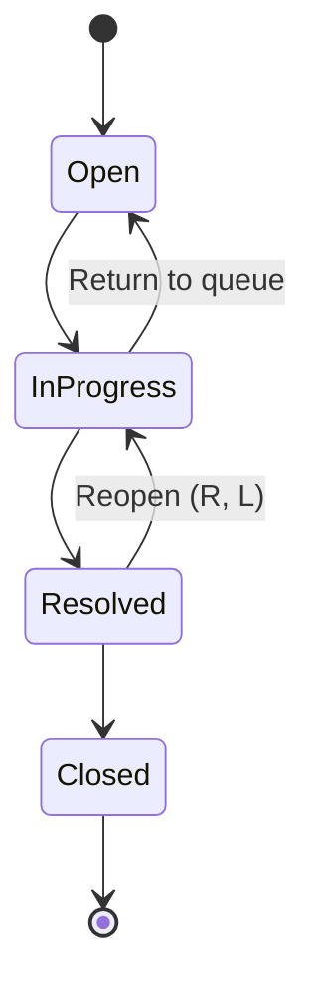
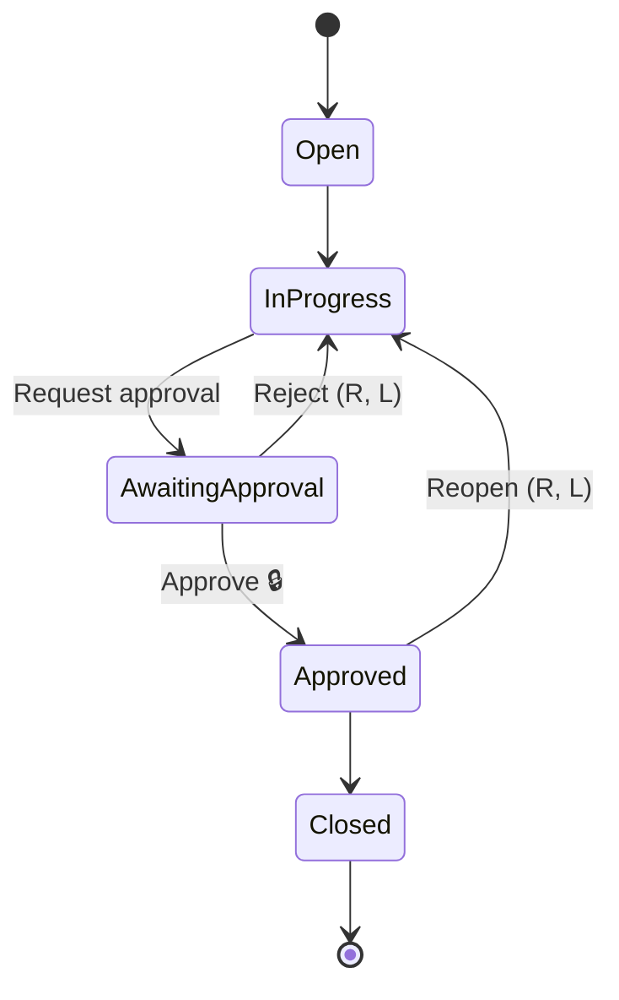
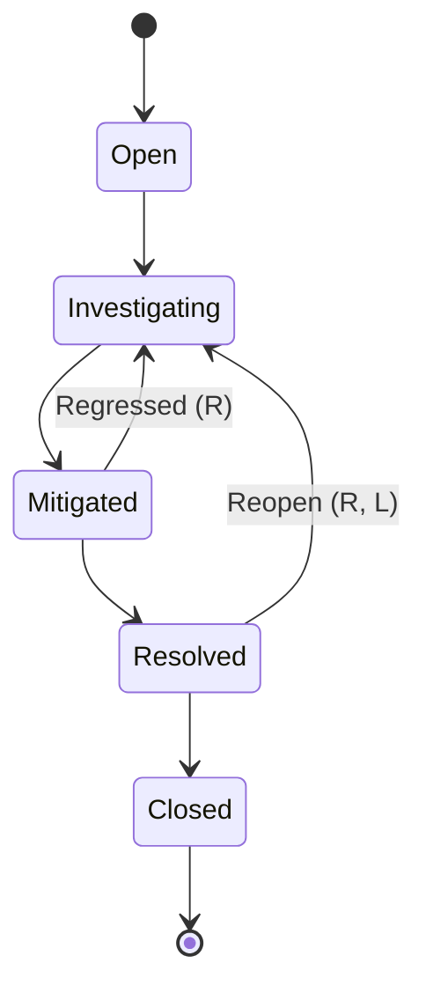

# 4. Workflow & Rules

## 4.1 Concepts

A project's workflow is a **directed graph** stored as data:

* **Stages** (`workflow_stages`) — kind `start` (new items land here; exactly one), `active`, or
  `done` (counts as completed). A stage may be **protected** (`requires_approval`): entering it is
  an approval decision.
* **Transitions** (`workflow_transitions`) — an allowed move from one stage to another. Flags:
  `requires_reason`, `lead_only`.

The canvas draws exactly this graph (stage frames + connections). What the user sees is what the
server enforces.

## 4.2 Templates

A new project copies one template. After that, the project's workflow can be edited on its canvas.
Protected stages are marked 🔒; `R` = reason required; `L` = Lead/Manager only.

### Standard (Customer Escalations)

### Approval (Vendor Payments, SOC2 Evidence)

### Incident (Production Incidents)

Kinds: `Open` = start; `Resolved`, `Approved`, `Closed` = done; everything else active.

## 4.3 Moving an item: `checkTransition()`

A pure function in `domain/transitions.ts`. Input: workflow, item (with open blocker count), actor
(with role in the item's project), request (`toStageId`, `version`, `reason`). It returns the
matched transition or throws the **first** failing rule:

| # | Rule | Error |
|---|---|---|
| 1 | Item not deleted | 410 `ITEM_DELETED` |
| 2 | Actor may move this item: Lead/Manager always; Member only if assignee | 403 `NOT_ASSIGNEE` |
| 3 | A live transition exists from the item's current stage to `toStageId` | 422 `INVALID_TRANSITION` |
| 4 | Transition is `lead_only` → actor is Lead/Manager | 403 `LEAD_OR_MANAGER_REQUIRED` |
| 5 | Target stage is protected → actor is Lead/Manager | 403 `APPROVAL_ROLE_REQUIRED` |
| 6 | Target stage is protected → actor is not the creator and not the assignee | 403 `SELF_APPROVAL_FORBIDDEN` |
| 7 | Target stage is `done` → item has no open blockers | 409 `BLOCKED_BY_OPEN_ITEMS` |
| 8 | Transition `requires_reason` → non-empty reason (≤ 1,000 chars) | 422 `REASON_REQUIRED` |
| 9 | `version` equals the item's current version | 409 `VERSION_CONFLICT` |

The version check is last so a conflict response describes a *valid* request that simply lost the
race. The same rules (1–7) power two lists in every item response, so the UI can never disagree
with the server:

* `allowedTransitions`: moves the user can make now (the selectable options of the stage dropdown);
* `blockedTransitions`: moves that exist but are refused for this user, with the rule's code and
  message (shown disabled: "Approved: someone else must approve").

Event recorded: `item.approved` if the target is protected; `item.reopened` if the source is `done`
and the target is not; `item.rejected` if the source has a connection into a protected stage and
the target is not done; otherwise `item.transitioned` (including done → done, e.g. Closed →
Archive). Data: `{from: {id, name, kind}, to: {id, name, kind}, transitionId, reason, unblocks}`.

## 4.4 Editing the workflow (canvas)

### Who can do what

| Edit | Member | Lead / Manager |
|---|---|---|
| Add an `active` stage | ✓ | ✓ |
| Rename a stage, move its frame | ✓ | ✓ |
| Delete an empty, unprotected, non-start stage | ✓ | ✓ |
| Add a transition with no flags | ✓ | ✓ |
| Delete a transition with no flags that does not enter a protected stage | ✓ | ✓ |
| Change stage kind (start / active / done) | – | ✓ |
| Protect / unprotect a stage | – | ✓ |
| Set or clear `requires_reason` / `lead_only` | – | ✓ |
| Delete a protected stage, or a flagged / protected-entry transition | – | ✓ |

### Invariants (checked by `analyzeWorkflow()` in `domain/workflow-graph.ts` after every edit)

| # | Invariant | Result if broken |
|---|---|---|
| I1 | Exactly one `start` stage (making another stage `start` demotes the old one) | 422 `WORKFLOW_INVALID` (`reason: "START_STAGE"`); the start stage cannot be deleted |
| I2 | Every stage is reachable from the start stage | **Warning** `UNREACHABLE_STAGE` shown on the stage frame |
| I3 | From every non-done stage, some `done` stage is reachable (no dead ends) | **Warning** `DEAD_END` shown on the stage frame |
| I4 | **No approval bypass:** if the workflow has any protected stage, no `done` stage is reachable from start without passing through a protected stage | 422 `WORKFLOW_INVALID` (`APPROVAL_BYPASS`) |
| I5 | A stage containing live items cannot be deleted | 409 `STAGE_NOT_EMPTY` (with item count) |
| I6 | Stage names unique within the project | 409 `STAGE_NAME_TAKEN` |

**Why I2 and I3 are warnings, not errors** (changed during implementation): editing a graph on a
canvas happens in steps. A stage that was just added has no connections yet; adding the first
connection to it creates a temporary dead end. Rejecting those intermediate states would make the
canvas unusable. They are harmless to correctness (at worst an item waits in a stage until someone
adds a way out), so they are shown as warnings on the frame (`DETACHED_STAGE`, `UNREACHABLE_STAGE`,
`DEAD_END`). I1 and I4 stay hard errors because breaking them breaks the system: no place for new
items, or a way around approval.

**Insert a step between two steps** is one atomic operation (`insertOnTransitionId` when adding a
stage): A→B becomes A→new→B, in one transaction, so there is never an intermediate state.

I4 is checked by removing protected stages from the graph and running a breadth-first search from
start: if any `done` stage is still reachable, there is a path that skips approval. This is what lets
Members add new steps freely without being able to route a payment around its approval. Example:
a Member adding `In Progress → Closed` in the Approval workflow is rejected with `APPROVAL_BYPASS`.

### Concurrency for workflow edits

* Every workflow edit runs in a transaction that first takes `SELECT … FROM workflows WHERE
  project_id = $1 FOR UPDATE`. Edits to one project's workflow are therefore serialized, so two
  edits that are each valid alone cannot combine into an invalid graph. The edit then validates the
  **resulting** graph and bumps `workflows.version`.
* Every item transition takes `FOR SHARE` on the same row. Transitions run in parallel with each
  other, but a workflow edit waits for in-flight transitions (and vice versa). An item can never move
  along a connection that is being deleted, or into a stage that is being deleted.
* Adds do not require a version (two people adding two stages both succeed). Renames and flag
  changes on a single stage/transition use that row's `version` (409 `VERSION_CONFLICT`).

## 4.5 Item lifecycle rules

| Action | Rule |
|---|---|
| Create | Any member. Lands in the start stage. Members may set assignee only to themselves or none; Leads/Managers to any current member. Gets the next number atomically. |
| Claim | Any member, item unassigned and not deleted. Atomic conditional update. |
| Release | The assignee (or a Lead/Manager) gives the item back (assignee → null). Version checked. |
| Assign / reassign | Lead/Manager, reason required, target must be a current member. Version checked. |
| Edit title / description / type / due date | Manager only. Version checked. |
| Change priority | Lead/Manager, reason required. Version checked. |
| Set next action | Assignee, Lead or Manager. Version checked. |
| Add note | Any member. Notes are immutable. |
| Add / remove "blocked by" link | Any member. Same project, no cycles (recursive CTE from the blocker following existing links back to the blocked item). |
| Delete | Manager only, reason required. Soft delete. Version checked. |
| Restore | Manager only, reason required. |

Every action writes one activity event and one `event` outbox job in its transaction (both via
`recordEvent()` in `services/activity.ts`), and updates `last_activity_at`. Notes and links don't
bump the item's `version`, so they never cause edit conflicts.

**Open blockers** = links whose blocker item is not deleted and not in a `done` stage. When a
blocker reaches a `done` stage, the blocked item's members are notified as part of the normal
notification for that event (the notification text mentions what it unblocked).

## 4.6 Dashboard definitions

All are restricted to projects where the caller is a current member and to non-deleted items.

| View | Definition |
|---|---|
| Assigned to me | `assignee_id = me` and stage not `done` |
| Next actions due | `assignee_id = me`, `next_action` set, `next_action_due_at <= end of today` |
| Overdue | `due_at < now()` and stage not `done` |
| Awaiting my approval | I am Lead/Manager of the project; the item's current stage has an outgoing transition into a protected stage; I am not its creator or assignee |
| Unassigned urgent | `assignee_id IS NULL`, `priority <= 2`, stage not `done` |
| Blocked | stage not `done` and at least one open blocker |
| Forgotten | stage not `done` and `last_activity_at < now() − 5 days` |

Each card on Home shows a count; counts above 999 display as "999+" (the count query stops at
1,000 with `LIMIT`, so it stays cheap).
