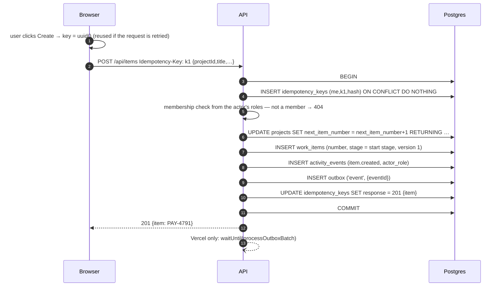
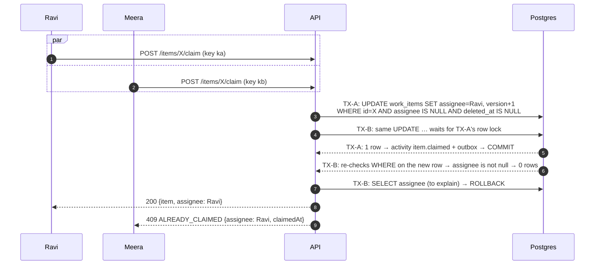
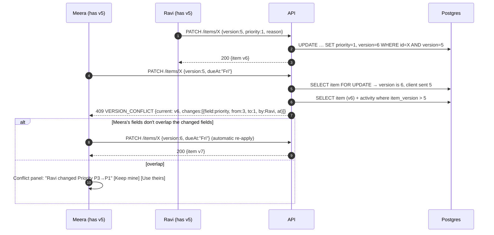
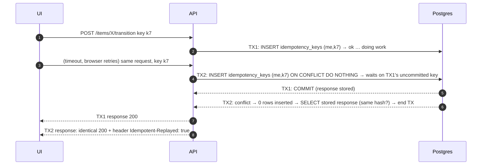
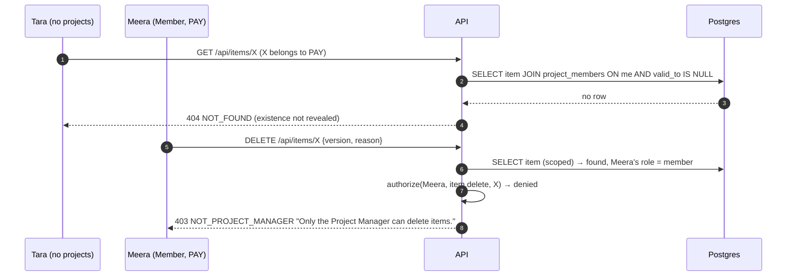
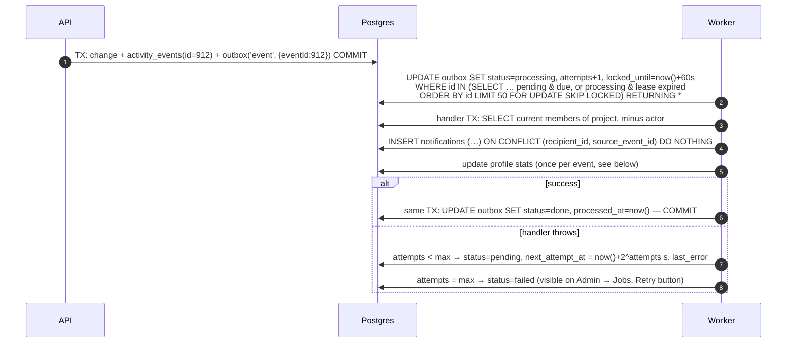

# 5. Data Flows

Each section shows one critical behaviour end to end. "TX" means a single database transaction.

## 5.1 Create an item

Demonstrates idempotency, the atomic per-project counter, and the change + activity + outbox rule.



Two creates at the same instant both lock the project row briefly for the counter update; the second
gets the next number. Numbers are unique and gap-free per project except where a transaction rolls back.

## 5.2 Two people claim the same item



Why it is correct: in Postgres' default READ COMMITTED level, an `UPDATE` that waited on a row lock
re-evaluates its `WHERE` clause against the committed row. The condition `assignee IS NULL` is part
of the write itself, so there is no gap between "check" and "act".

## 5.3 Stale edit (optimistic locking) and the conflict panel



`Keep mine` re-sends Meera's values with `version: 6`; it can conflict again if someone else saved
in between, and the same flow repeats.

**Forms send the version they were opened with.** The item page refreshes every 15 s, so by the time
Meera clicks Save the page may already hold v6. Edit details, priority, next action and reassign
therefore remember the version from when the form/dialog was opened (`baseVersion` in
`components/itemActions.ts`) and send that, never the latest polled one; otherwise a background
refresh would turn into a silent overwrite. While a form is open and a newer version arrives, it
shows "This item was updated while you were editing. Saving checks for conflicts."

## 5.4 Retried or double-clicked request (idempotency)



Cases:

| Situation | Result |
|---|---|
| Same key, first request committed | Stored response replayed; nothing written |
| Same key, first request failed (rolled back) | Key row was rolled back too, so the retry runs normally |
| Same key, first still running | Second waits on the unique index, then replays |
| Same key, different body hash | 422 `IDEMPOTENCY_KEY_REUSED` |
| Key missing on an endpoint that needs one | 428 `IDEMPOTENCY_KEY_REQUIRED` |

Only successful (2xx) and deterministic 4xx business outcomes (403/404/409/410/422) are stored. A 5xx
is never stored, so a retry after a server error can succeed. The client generates one key per user
**intent** and reuses it for every retry of that intent.

## 5.5 Move a card into a protected stage (approval)

```mermaid
sequenceDiagram
    autonumber
    participant L as Ravi (Lead)
    participant API
    participant DB as Postgres
    L->>API: POST /items/X/transition {toStageId: Approved, version: 8}  key k9
    API->>DB: BEGIN; INSERT idempotency key
    API->>DB: SELECT workflows WHERE project_id=P FOR SHARE
    API->>DB: SELECT item X (scoped to Ravi's projects) FOR UPDATE
    API->>DB: load stages/transitions; count open blockers
    API->>API: authorize(Ravi, item.transition, X)
    API->>API: checkTransition(): transition exists ✓, protected → Lead ✓,<br/>Ravi ≠ creator ✓, Ravi ≠ assignee ✓, no blockers ✓, version 8 ✓
    API->>DB: UPDATE item SET stage=Approved, version=9
    API->>DB: INSERT activity (item.approved, actor_role=lead)
    API->>DB: INSERT outbox ('event'); store response; COMMIT
    API-->>L: 200 {item v9}
```

Failure examples: Meera (Member) → 403 `APPROVAL_ROLE_REQUIRED`. Ravi approving an item Ravi created →
403 `SELF_APPROVAL_FORBIDDEN`. Open → Closed → 422 `INVALID_TRANSITION`. A workflow edit deleting the
`Awaiting Approval → Approved` connection waits for this transaction (it needs `FOR UPDATE` on the same
`workflows` row).

## 5.6 Authorization at the resource level



Roles are read from `project_members` on every request; the session cookie only identifies the user.
Removing someone from a project takes effect on their next request.

## 5.7 Notifications via the transactional outbox



| What goes wrong | What happens |
|---|---|
| Worker crashes after claiming | `locked_until` passes; the next run reclaims the job; the unique constraint prevents duplicates |
| Two workers run at once | `SKIP LOCKED`: each claims different rows |
| Job processed twice | `ON CONFLICT DO NOTHING`: one notification per recipient |
| Job delayed (worker idle) | Primary action already committed; notification shows the event's own timestamp |
| Poison job | After 5 attempts → `failed`; never blocks other jobs; Admin can retry |
| Member removed before job runs | Recipients are computed when the job runs, so they are not notified |

**Canvas digest** (`canvas.changed`, one job per canvas save): for each recipient, upsert the
notification with `digest_key = canvas:<project>:<actor>:<window>` (`ON CONFLICT DO UPDATE SET
created_at = now(), read_at = NULL`), then `INSERT notification_sources (notification_id,
'outbox:<jobId>') ON CONFLICT DO NOTHING`. The shown count is `COUNT(notification_sources)`, so a
retried job never double-counts.

**Stats** (part of the same `event` job): `INSERT processed_stat_events(event_id) ON CONFLICT DO
NOTHING`; if nothing was inserted the event was already counted, so skip; otherwise increment
`user_project_stats`. Both happen in the handler's transaction, together with marking the job done.

## 5.8 Optimistic UI and reconciliation

```mermaid
sequenceDiagram
    autonumber
    participant U as User
    participant Q as Query cache
    participant API
    U->>Q: drag card PAY-4790 from In Progress to Approved
    Q->>Q: onMutate: snapshot; move card locally (instant)
    Q->>API: POST /items/X/transition {version: 8}
    alt 200
        API-->>Q: item v9 → replace cached item
    else 403 / 422 / 409 / 410
        API-->>Q: error envelope
        Q->>Q: onError: restore snapshot (card snaps back)
        Q->>U: toast with server message ("Only a Lead can approve")
        Q->>API: reload the canvas so nothing stale remains
    end
    Q->>API: onSettled: fetch the changes feed now (picks up the new version and counts)
```

The same pattern (`useSafeMutation` in `frontend/src/api/mutation.ts`) is used everywhere: one
idempotency key per user intent, reused when a network error or 503 is retried (up to 2 retries).

## 5.9 Seeing other people's changes (changes feed)

```mermaid
sequenceDiagram
    autonumber
    participant UI as Canvas (open)
    participant API
    participant DB as Postgres
    loop every 3 s (1 s while changes arrive), after own writes, and on window focus
        UI->>API: GET /projects/P/changes?since=T0
        API->>DB: items, canvas elements, stages, transitions WHERE updated_at > T0 − 30 s<br/>(+ deleted rows), project & workflow versions
        API-->>UI: {serverTime: T1, items[], elements[], workflow?, project?}
        UI->>UI: apply only versions not applied yet: patch moved cards into their new stage,<br/>skip elements with a pending local edit; highlight moved cards
        UI->>UI: since = T1
    end
```

On an open item page the read-only fields simply update (every 15 s). An open form keeps what the
user typed and shows "This item was updated while you were editing" (see §5.3).

## 5.10 Canvas batch move with a conflict

```mermaid
sequenceDiagram
    autonumber
    participant A as Ravi
    participant API
    participant DB as Postgres
    A->>API: PATCH /projects/P/canvas/elements {changes:[{id:e1,version:3,x,y},{id:e2,version:7,x,y}]}
    API->>DB: BEGIN
    API->>DB: UPDATE canvas_elements SET … version+1 WHERE id=e1 AND version=3 AND deleted_at IS NULL → 1 row
    API->>DB: UPDATE … WHERE id=e2 AND version=7 → 0 rows (Meera moved e2)
    API->>DB: ROLLBACK (e1 is not saved either)
    API-->>A: 409 ELEMENT_CONFLICT {conflicts:[{id:e2, current:{…version 8, updatedBy: Meera}}]}
    A->>A: replace e2 with server copy, revert e1 to last saved; toast "Meera moved this"
```

All-or-nothing keeps a group move from being half applied. Element creates use client-generated
UUIDs: repeating a create with the same id and same creator returns the existing element (200).

## 5.11 Delete and restore

1. Manager sends `DELETE /items/X {version, reason}` with an idempotency key.
2. TX: authorize (`item.delete` → Manager) → `UPDATE … SET deleted_at, deleted_by, delete_reason, version+1 WHERE version = $v` → activity `item.deleted` → outbox.
3. The item disappears from lists, canvas and search (all queries filter `deleted_at IS NULL`);
   the changes feed sends it with `deleted: true` so open screens remove it.
4. Anyone acting on it afterwards gets 410 `ITEM_DELETED` naming who deleted it and why.
5. The Manager sees deleted items under *Project → Deleted items* and can restore with a reason.
