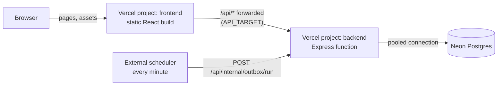

# 12. Deployment

## 12.1 Local (reviewer path)

Prerequisites: Docker Desktop (Docker Compose 2.24 or newer). Nothing else.

```bash
git clone https://github.com/Alok-kumar-priyadarshi/newtonite-ops-2300970100033.git
cd newtonite-ops-2300970100033
docker compose up --build
```

Open http://localhost:8080 and use "Sign in as…" (password for every demo user: `Demo@1234`).

`docker-compose.yml` services:

| Service | Image / build | Purpose |
|---|---|---|
| `db` | `postgres:17-alpine`, volume `pgdata`, healthcheck `pg_isready` | Database |
| `migrate` | API image, `node backend/dist/migrate.js && node backend/dist/seed.js` | Runs once and exits; the seed is skipped if data exists |
| `api` | API image (multi-stage build that also builds the web app), `node backend/dist/server.js`, port 8080 | API + serves the built SPA |
| `worker` | API image, `node backend/dist/worker.js` | Outbox loop every 2 s; housekeeping every 10 min (expired idempotency keys, old presence and finished jobs) |

`api` and `worker` start after `migrate` completes successfully.

The database is published on host port **5433** (not 5432) so it never clashes with a Postgres
already installed on the machine.

### Developer mode (hot reload)

Prerequisites: Docker and Node 20+.

```bash
npm install
npm run dev     # starts the db container, migrates, seeds, then API (:8080), worker and Vite (:5173)
```

`npm run dev` creates `backend/.env` and `frontend/.env` from their `.env.example` files on first run. Open http://localhost:5173.

## 12.2 Tests

```bash
npm test
```

Starts `docker-compose.test.yml` (Postgres on port 55432, tmpfs storage) if it is not running, runs
migrations, then runs all API unit/integration tests and web tests.

## 12.3 Environment variables

| Variable | Example | Used by |
|---|---|---|
| `DATABASE_URL` | `postgres://nops:nops@db:5432/nops` | API, worker, migrations |
| `SESSION_SECRET` | 32+ random characters | API |
| `DEMO_MODE` | `true` | Enables "Sign in as…" list |
| `CRON_SECRET` | random | `/api/internal/outbox/run` |
| `APP_ORIGIN` | `http://localhost:8080` | Cookie and redirect settings |
| `PORT` | `8080` | API |
| `DB_POOL_MAX` | `10` | API/worker pool size |
| `GROQ_API_KEY` | empty (assistant off) | API: switches on the ✨ Ask assistant |
| `GROQ_MODEL` | `openai/gpt-oss-120b` | API: model for the assistant |
| `VITE_API_URL` | empty | Web build: API URL when the frontend is hosted on another domain; empty = same domain |
| `CORS_ORIGINS` | `https://app.example.com` | API: frontend origins on other domains (enables CORS and `SameSite=None` cookies) |
| `API_TARGET` | `https://newtonite-api.vercel.app` | Web: where `/api` is forwarded (Vite dev server locally; the frontend Vercel project in production) |
| `DB_IDLE_TIMEOUT` | `0` | Seconds before idle DB connections close. `0` (keep open) for Docker/long-running servers; set e.g. `20` on serverless so functions release connections |

Backend variables live in `backend/.env`, frontend variables in `frontend/.env`. Each folder commits a
`.env.example` with safe placeholder values; the `.env` files are git-ignored. No secrets in the repository.

## 12.4 Production demo: Vercel + Neon (two projects)

The backend and frontend deploy as **two Vercel projects from the same repository**, one per folder.



> **Status:** both builds and the bundled function have been verified locally (the function was run
> standalone against Postgres). The Vercel deployment itself is not part of the automated tests;
> Docker remains the reference setup.

| | Backend project | Frontend project |
|---|---|---|
| Root Directory | `backend` | `frontend` |
| Build | `backend/scripts/vercel-build.mjs`: bundles `src/vercel.ts` with esbuild into one self-contained function serving `/api/*` | `frontend/scripts/vercel-build.mjs`: Vite build as static files, SPA fallback to `index.html`, and `/api/*` forwarded to `API_TARGET` |
| Settings | `backend/vercel.json` (install runs `npm ci` at the repo root, because the workspace includes `shared/`) | `frontend/vercel.json` (same) |

Bundling is required because the API is ES-module TypeScript with extensionless imports and a
TypeScript workspace package, which Node cannot load directly.

**Why the frontend forwards `/api` instead of calling the backend URL.** Two `*.vercel.app`
projects are different sites to the browser. Forwarding keeps the browser on one site, so no CORS is
needed and the session cookie stays first-party (Safari blocks third-party cookies). Calling the
backend directly is possible with `VITE_API_URL` on the frontend and `CORS_ORIGINS` on the backend,
but sign-in then fails in browsers that block third-party cookies.

Steps:

1. **Neon:** create a project; copy the **pooled** connection string (host contains `-pooler`) and
   the direct one. Remove `&channel_binding=require` if present.
2. **Schema and demo data,** once, from a local machine with the direct string:
   `DATABASE_URL=<direct url> npm run db:migrate && npm run db:seed`.
3. **Backend project:** import the repo, Root Directory `backend`, Framework Preset **Other**, no
   build overrides. Environment variables:

   | Variable | Value |
   |---|---|
   | `DATABASE_URL` | Neon pooled string |
   | `SESSION_SECRET` | 32+ random characters |
   | `CRON_SECRET` | random string |
   | `DEMO_MODE` | `true` |
   | `APP_ORIGIN` | the **frontend** URL, e.g. `https://newtonite-web.vercel.app` (users open it; `https` enables secure cookies) |
   | `DB_POOL_MAX` / `DB_IDLE_TIMEOUT` | `1` / `20` |
   | `GROQ_API_KEY` | optional |

   Choose a function region close to the Neon region. Check `https://<backend>/api/health`.
4. **Frontend project:** import the same repo again, Root Directory `frontend`, Framework Preset
   **Other**, no build overrides. Environment variable `API_TARGET` = the backend URL, e.g.
   `https://newtonite-api.vercel.app`. Changing it requires a redeploy.
5. **Scheduler:** a job (e.g. cron-job.org) calling `POST https://<backend>/api/internal/outbox/run`
   every minute with headers `X-Cron-Secret: <secret>` and `X-Requested-With: newtonite-ops`.

"Include files outside the Root Directory" must stay enabled (the default) in both projects, since
both build against `shared/`. Every push redeploys both projects.

Serverless notes:
* The Postgres driver uses `prepare: false` (Neon's pooler runs in transaction mode); set
  `DB_POOL_MAX=1` per function instance.
* Transactions are short (no user think-time inside a transaction), which suits transaction pooling.
* `waitUntil()` from `@vercel/functions` drains a few outbox jobs after each write so notifications
  usually arrive within seconds; the scheduler is the safety net.
* Free tiers change; check current Vercel and Neon limits before relying on them.
