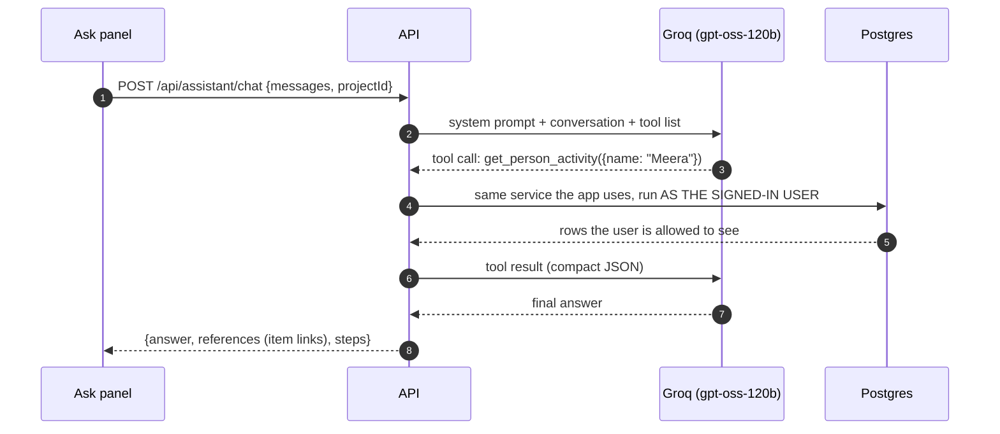

# 13. Ask: the AI Assistant

An optional chat panel (**✨ Ask**, on the canvas and the list pages) that answers questions about the
work the user can see: *"What is Meera working on?"*, *"Which P1 items are unassigned?"*, *"What did
Ravi approve today?"*. It uses Groq's OpenAI-compatible API with the `openai/gpt-oss-120b` model.

## 13.1 Setup

Add a Groq API key (https://console.groq.com/keys) to `backend/.env` and restart the
server:

```
GROQ_API_KEY=gsk_...
GROQ_MODEL=openai/gpt-oss-120b      # optional, this is the default
```

Docker Compose passes both values from `backend/.env` to the API. Without a key the panel explains how to
switch it on and `POST /api/assistant/chat` returns 503 `ASSISTANT_DISABLED`; everything else works
as before. The key stays on the server; the browser never sees it.

## 13.2 How it works



**The model never touches the database.** It can only ask for one of six read-only tools, and the
server runs each one through the existing services with the signed-in user's permissions:

| Tool | Answers | Built on |
|---|---|---|
| `search_items` | "P1 items in review", "what does X own", "overdue payments" | `listItems` (filters, search, views) |
| `get_item` | "what's happening with PAY-42" | `getItem` + item activity |
| `get_person_activity` | "what is X doing / did last" | people profile + person activity |
| `list_projects` | "how are my projects doing" | `listProjects` |
| `list_members` | "who's on this project" | `listMembers` |
| `get_my_dashboard` | "what needs my attention" | `getDashboard` |

The loop allows up to 6 tool calls per question, then forces a final answer. The server is
stateless: the browser sends the last 10 turns each time and keeps the conversation for the tab.

## 13.3 Safety and limits

| Concern | Handling |
|---|---|
| Seeing data the user can't | Impossible by construction: tools run as the user; names, projects and stages are resolved only within the user's projects; a `projectId` the user isn't in is ignored |
| Changing data | No write tools exist; the assistant explains how to do it in the app instead |
| Prompt injection via item titles/notes | Tool data is marked as user-written data in the system prompt; even if the model is misled, it has no write tools and no access beyond the user |
| Made-up answers | The prompt requires answers only from tool results; item keys in answers are linked only if they came from tool results |
| Cost / runaway use | 15 questions per user per minute (in-memory, per server process); ≤ 6 tool calls per question; tool results capped at 20 rows and 12 KB; 30 s timeout |
| Bad key / provider down | Clear message ("rejected the API key", "did not respond"); the rest of the app is unaffected |
| Provider rate limit (429) | One automatic retry after a short wait (respecting `Retry-After`, max 4 s), then "busy, try again" |
| Item keys written with typographic dashes (`PAY‑42`) | Normalised to `PAY-42` so they are recognised and linked |

**Checked against the real model** (`openai/gpt-oss-120b` on Groq): answers in about 1–2 s; Ravi asking
"What is Meera working on?" gets her recent work with linked keys; "Which P1 items are unassigned?"
returns "8 of 32" with links; Tara asking about Meera is told no such person exists in her projects.
On Groq's free tier, several questions within a minute can hit the provider's tokens-per-minute
limit (429); the app retries once and then says so.

Known limitations: the rate limit is per process (not shared across instances); answers are not
streamed; the conversation is not stored on the server; the model decides which tools to call, so
answer quality varies with phrasing.

## 13.4 Tests

`backend/test/assistant.test.ts` replaces Groq with a scripted fake and checks: switched off without
a key (503); a tool call is executed as the user and its result returned to the model; an outsider
gets no data from another project (search returns 0, people lookup fails, prompt lists only their own
project); malformed tool arguments and unknown items become recoverable tool errors; a rejected key
gives a clear error.
